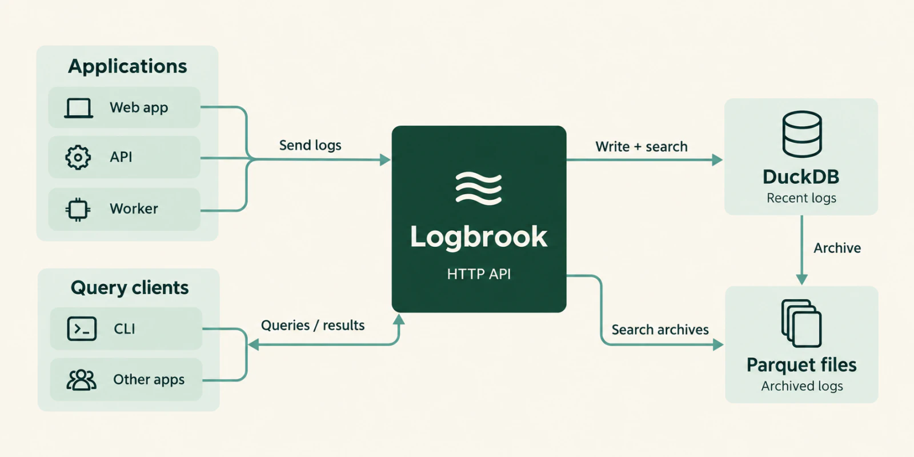

Logbrook is a self-hosted log search server for structured application logs. It runs on one server, as one executable with one data directory.

<Aside type="caution" title="Pre-release software">
Logbrook is at version 0.1.0. APIs and storage formats may change before a stable release.
</Aside>

## What it does

Logbrook receives JSON logs over HTTP, stores recent events in an embedded DuckDB database, moves older events into local Parquet files, and searches both through its CLI and HTTP API. It needs no external database or message queue.

## Main pieces

- **HTTP ingestion.** Applications send Pino-style JSON arrays or NDJSON with an ingestion token. Each token maps to a source. A request succeeds only after the batch is committed. See [Send logs over HTTP](/send-logs/http/).
- **Named indexes.** Each index has its own retention period and disk-size target. The first authorized write to a new index creates it, up to a configurable limit. See [Indexes, services and sources](/concepts/indexes-services-sources/).
- **Search.** Filter by time range, source, service, logger, host, minimum level, message substring and exact attribute values. Results are paged, and the same filters drive counts, facets and histograms. See [Search and filter](/query/search/).
- **Live tail.** Follow new events over server-sent events, with replay after a reconnect and a notice when events were missed. See [Live tail](/query/live-tail/).
- **Parquet archival.** Older events move to local Parquet files and stay searchable together with recent ones. See [Archives and retention](/concepts/archives-and-retention/).
- **CLI.** The same executable is a client for a running server. See the [CLI reference](/reference/cli/).
- **Fluent Forward receiver.** Off by default. It accepts logs from Docker's `fluentd` logging driver, Fluentd and Fluent Bit. See [Docker and Fluent Forward](/send-logs/docker-forward/).
- **Offline import** of Pino JSON or NDJSON files. See [Import log files](/send-logs/import-files/).

## Credentials

Each role has its own bearer token: ingestion (write events), read (search and tail), and optionally admin (manage indexes). No two roles can share a token. See [Credentials and roles](/configure/credentials/).

## When it fits

- You run one server, or a small group of services, and want to search structured logs without operating a database cluster or a queue.
- Your applications can emit JSON, or you can forward their output with Fluent Forward.
- Filtering by fields is enough, and you don't need a query language.

## What it does not do

- No clustering or replication. It is a single node.
- No query language. Searches use structured filters, not SQL, Lucene or KQL.
- No TLS on the HTTP API. It serves plain HTTP, so put a TLS-terminating reverse proxy in front of it before exposing it beyond the local machine.

## Next steps

<CardGrid>
  <LinkCard title="Quickstart" description="Run the container, send an event, and search it." href="/get-started/quickstart/" />
  <LinkCard title="Run with Docker Compose" description="A persistent deployment." href="/get-started/docker-compose/" />
  <LinkCard title="Events and time" description="How Logbrook models a log event." href="/concepts/events-and-time/" />
</CardGrid>
