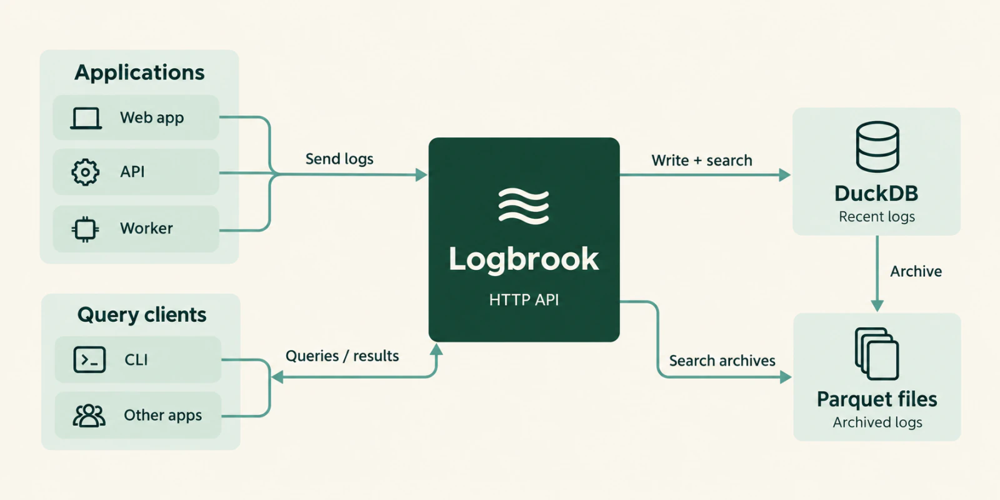

Logbrook is a self-hosted log search server for structured application logs. It is a single Rust executable that receives JSON logs over HTTP, stores them in embedded DuckDB and local Parquet files, and searches them through a CLI and an HTTP API.


<Aside type="caution" title="Pre-release software">
Logbrook is at version 0.1.0. APIs and storage formats may change before a stable release.
</Aside>

## Try it

This starts Logbrook with throwaway credentials and no persistent volume. The [quickstart](/get-started/quickstart/) walks through sending and searching an event.

```sh
docker run --rm -p 127.0.0.1:3100:3100 \
  -e LOGBROOK_INGEST_TOKEN="$(openssl rand -hex 24)" \
  -e LOGBROOK_READ_TOKEN="$(openssl rand -hex 24)" \
  ghcr.io/sandrinodm/logbrook:0.1.0
```

<div class="flex flex-wrap gap-3">
  <LinkButton href="/get-started/quickstart/" variant="primary">Quickstart</LinkButton>
  <LinkButton href="/get-started/overview/" variant="secondary">What is Logbrook</LinkButton>
</div>

## How it works

Applications send logs to Logbrook over HTTP. Each index keeps recent events in embedded DuckDB and moves older events into local Parquet archives. Searches read both stores, so archived events stay searchable. The CLI and other applications query through the same HTTP API.



Logbrook runs on one server with one data directory. It needs no external database or message queue.

## Features

<CardGrid>
  <Card title="HTTP ingestion" icon="ph:upload-simple">
    Send Pino-style JSON arrays or NDJSON. A request succeeds only after the batch is committed. [Learn more](/send-logs/http/).
  </Card>
  <Card title="Named indexes" icon="ph:stack">
    Each index has its own retention period and disk-size target. [Learn more](/concepts/indexes-services-sources/).
  </Card>
  <Card title="Search, facets, histograms" icon="ph:magnifying-glass">
    Filter by time, source, service, level, message and attributes. Count, group and bucket the results. [Learn more](/query/search/).
  </Card>
  <Card title="Live tail" icon="ph:broadcast">
    Stream new events over server-sent events, with replay after a reconnect. [Learn more](/query/live-tail/).
  </Card>
  <Card title="Parquet archival" icon="ph:archive">
    Older events move to local Parquet files and stay searchable. [Learn more](/concepts/archives-and-retention/).
  </Card>
  <Card title="CLI" icon="ph:terminal-window">
    The same executable queries, counts and manages indexes on a running server. [Learn more](/reference/cli/).
  </Card>
  <Card title="Fluent Forward" icon="ph:plugs-connected">
    An optional receiver for Docker's fluentd logging driver, Fluentd and Fluent Bit. [Learn more](/send-logs/docker-forward/).
  </Card>
  <Card title="Operations" icon="ph:gauge">
    Health and readiness endpoints, Prometheus metrics, and a Distroless image that runs as UID 10001. [Learn more](/operate/production/).
  </Card>
</CardGrid>

## Where to go next

<CardGrid>
  <LinkCard title="Get started" description="Run Logbrook and search your first event." href="/get-started/quickstart/" />
  <LinkCard title="Concepts" description="Events, indexes, search and retention." href="/concepts/events-and-time/" />
  <LinkCard title="Send logs" description="HTTP, Pino, Docker and file import." href="/send-logs/http/" />
  <LinkCard title="Query" description="Filters, aggregations, export and live tail." href="/query/search/" />
  <LinkCard title="Configure" description="Config file, credentials, indexes and retention." href="/configure/configuration-file/" />
  <LinkCard title="Operate" description="Production setup, limits, metrics and backups." href="/operate/production/" />
  <LinkCard title="Reference" description="CLI, HTTP API and glossary." href="/reference/cli/" />
  <LinkCard title="AI agents" description="Install and use the Logbrook agent skill." href="/ai-agents/agent-skill/" />
</CardGrid>

## FAQ

<AccordionGroup>
  <Accordion>
    <AccordionTrigger>Is Logbrook production ready?</AccordionTrigger>
    <AccordionContent>
      Not yet. It is pre-release software at version 0.1.0, and APIs and storage formats may change before a stable release. See [Run in production](/operate/production/) for what to plan for.
    </AccordionContent>
  </Accordion>
  <Accordion>
    <AccordionTrigger>What does it need to run?</AccordionTrigger>
    <AccordionContent>
      One executable and one writable data directory. There is no external database or message queue. Logbrook serves plain HTTP, so put a TLS-terminating reverse proxy in front of it before exposing it beyond the local machine.
    </AccordionContent>
  </Accordion>
  <Accordion>
    <AccordionTrigger>How do I get logs in?</AccordionTrigger>
    <AccordionContent>
      Post JSON arrays or NDJSON to the ingest endpoint with an ingestion token. See [Send logs over HTTP](/send-logs/http/) and [Node.js with Pino](/send-logs/pino/). Docker's fluentd logging driver, Fluentd and Fluent Bit can use the optional [Forward receiver](/send-logs/docker-forward/), and you can [import log files](/send-logs/import-files/) offline.
    </AccordionContent>
  </Accordion>
  <Accordion>
    <AccordionTrigger>What query language does it use?</AccordionTrigger>
    <AccordionContent>
      None. You search with structured filters: a time range, source, service, logger, host, minimum level, message substring, and exact attribute values. There is no SQL, Lucene or KQL. See [Search and filter](/query/search/).
    </AccordionContent>
  </Accordion>
  <Accordion>
    <AccordionTrigger>What happens to old logs?</AccordionTrigger>
    <AccordionContent>
      Events older than the archive age move into Parquet files and stay searchable. Events past the index's retention period, or beyond its disk-size target, are expired oldest first. See [Archives and retention](/concepts/archives-and-retention/).
    </AccordionContent>
  </Accordion>
</AccordionGroup>
