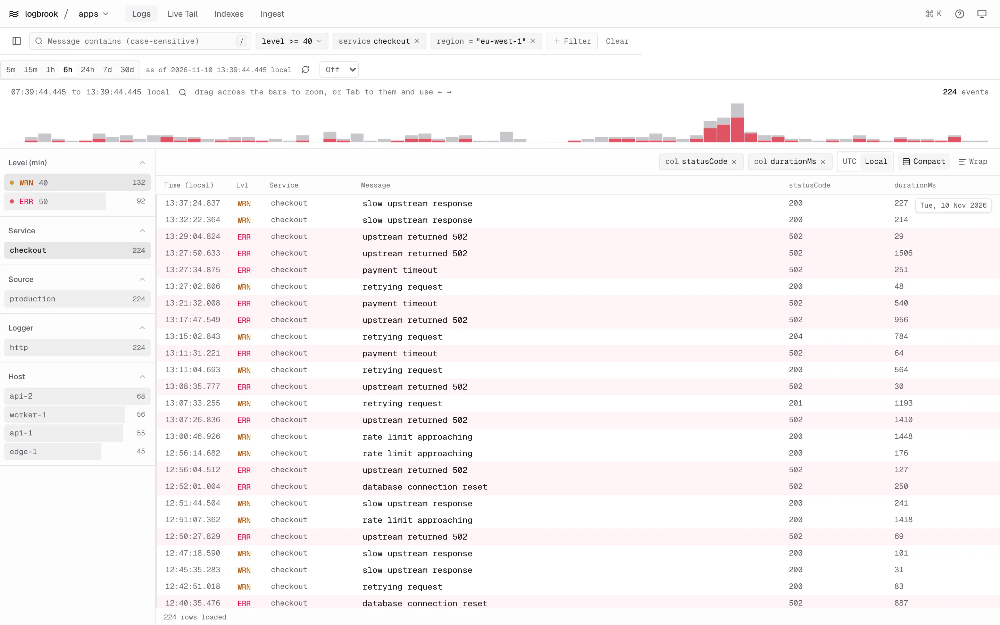
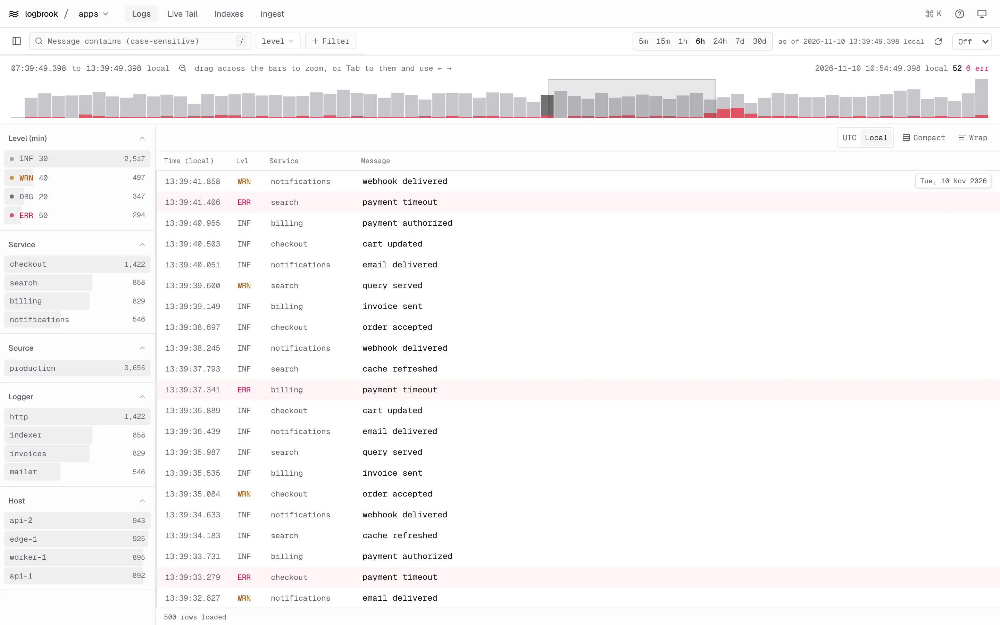
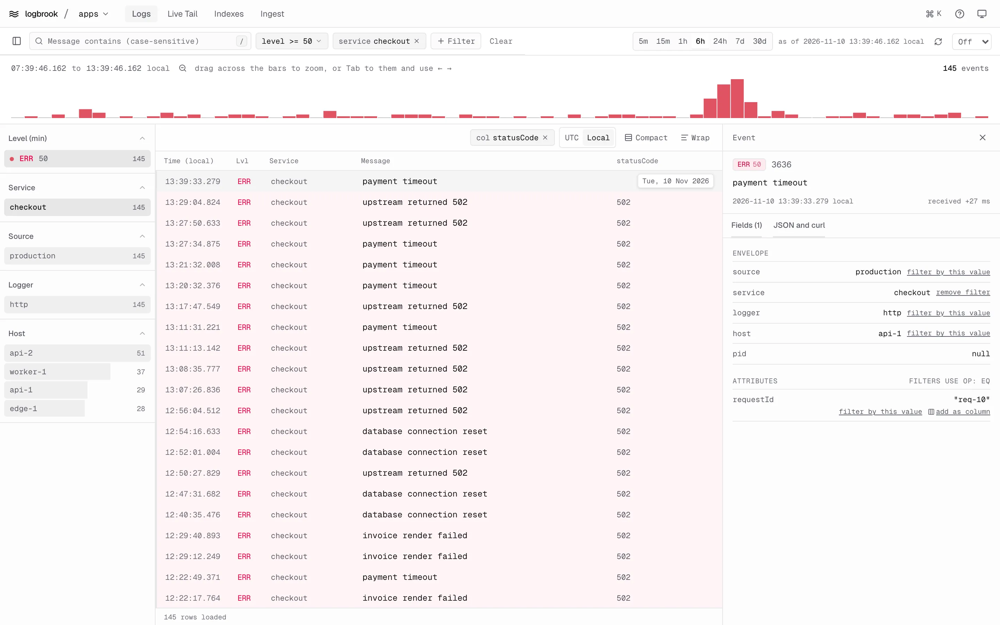

The **Logs** view searches one index over one time range. The filters, the histogram and the facet counts all describe the same set of events, and every change refetches them.

## Pick an index and a time range

The index switcher next to the logo chooses the index. When you open the UI without one, it uses `default` if that index exists and the first index in the list otherwise.

The range buttons are `5m`, `15m`, `1h`, `6h`, `24h`, `7d` and `30d`; the default is `1h`. A relative range is frozen at the moment you pick it, and the bar shows "as of" that time. The refresh button freezes a new "now". The auto-refresh menu repeats that every 5, 10, 30 or 60 seconds. Both are disabled while the range is fixed (see [Zoom the histogram](#zoom-the-histogram)); pick a preset to get them back.

The URL holds the index, range, filters and display settings, so you can bookmark or share a view. Opening a link reproduces it.

## Filter

Filters combine with AND. A filter that is set shows as a chip you can remove, and **Clear** removes them all.

| Filter | How to set it | Matches |
| --- | --- | --- |
| Message | The search box, or press `/` | A literal substring of the message. It is **case-sensitive**: `Error` does not match `error`. Matches are highlighted in the rows. |
| Level | The level menu | The chosen level and above: 20 debug, 30 info, 40 warn, 50 error, 60 fatal. |
| Service, logger, host | **Filter**, or a facet | An exact value. |
| Source | **Filter**, or a facet | One or more sources. Several sources are an OR list. |
| Attribute | **Filter**, then **attribute** | An attribute equal to a text, number or boolean value. Up to 16 attribute conditions. |

The filters map onto the search parameters described in [Search and filter](/query/search/) and [Attribute filters](/query/attribute-filters/). Attribute filters in the UI are always equality filters.

### Facets

The sidebar lists the values present in the current result for level, service, source, logger and host, with counts. Click a value to filter by it, and click it again to remove the filter. A level facet filters by *minimum* level, as the level menu does. Each section shows its first eight values and a **Show N more** link. The button at the left of the filter bar hides and shows the sidebar.

## Zoom the histogram

The histogram shows how many events fall in each time bucket, with the share at level error and above in red. The header shows the time span and the event count.

- **Drag** across the bars to zoom to that span. The range becomes fixed and the view refetches.
- **Zoom out** (the button at the left of the hint text) doubles the span, ending no later than now.
- **From the keyboard**, press `Tab` to focus the histogram. `←` and `→` move a cursor from bucket to bucket, `Home` and `End` jump to the ends, and `Shift` with an arrow extends a selection. `Enter` zooms to the selection, or to the bucket under the cursor, and `Esc` clears the selection. The header announces the bucket or selection for screen readers.

## Page through events

The table loads 500 events at a time, newest first, and fetches the next page as you scroll toward the end. The UI keeps at most 50,000 events loaded; when it reaches that, a notice at the bottom asks you to narrow the time range or the filters.

## Inspect an event

Click a row, press `Enter` on the focused row, or move with `j` and `k` (or the arrow keys) to open the event inspector. It shows the level, the message, the event time and how long after it Logbrook received the event.

- **Fields** lists the envelope (source, service, logger, host, pid) and the attributes. Each scalar value has **filter by this value** (a second click removes the filter) and **add as column**. Objects and arrays open as a tree.
- **JSON and curl** has two copy buttons: the event as JSON, and a `curl` command that searches the one millisecond around the event. The command uses `$LOGBROOK_READ_TOKEN` and the example address `http://127.0.0.1:3100`; it never contains a token. Adjust the address for your server.

The selected event is part of the URL. `Esc` closes the inspector.

## Change how the table looks

| Setting | Options |
| --- | --- |
| Columns | Pin attributes as extra columns with **add as column** in the inspector, up to six. Remove one with the **x** on its chip. |
| Time zone | **UTC** or **Local** (the browser's zone). The default is local. |
| Density | **Compact** rows, or comfortable rows (the default). |
| Wrap | **Wrap** shows long messages in full instead of cutting them off. |

These settings live in the URL too. When you go to Live Tail, Indexes or Ingest and come back to Logs, the UI restores the range, columns, density, time zone and wrap you had. The state is kept in memory for that tab, so a reload or a link opened directly starts clean.

## Theme

The theme follows your system by default. The button at the right of the top bar cycles system, light and dark and remembers the choice in the browser's `localStorage`.

## When something fails

Errors from Logbrook appear in the panel they affect, with a retry button. A rejected server token is reported as "the server's Logbrook token was rejected"; only the operator can fix it, by changing `LOGBROOK_READ_TOKEN` and restarting the UI. A `403` from Logbrook means the read token's source or index scope doesn't cover what you asked for.
