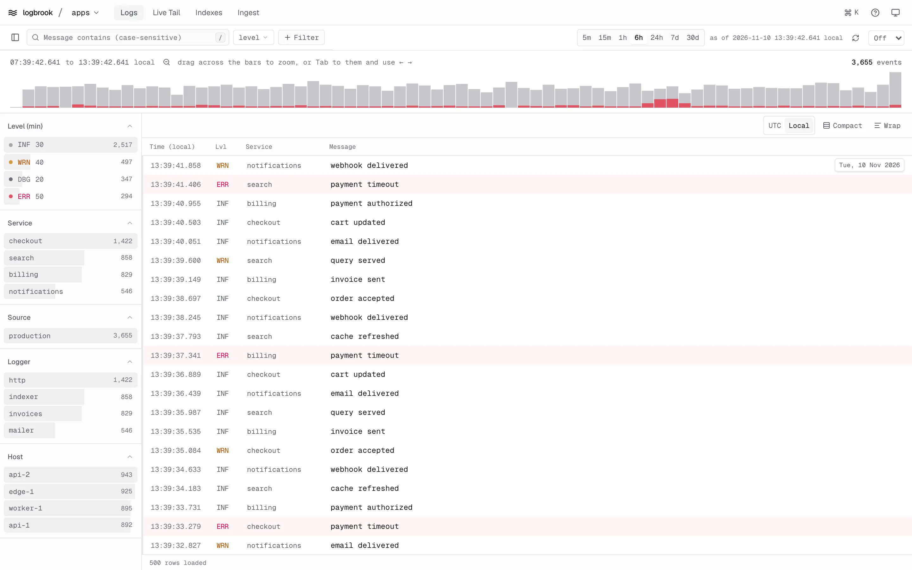

The Logbrook web UI is a separate app that talks to the Logbrook HTTP API. You use it to search and page through events, filter by facet, follow a live tail, look at index sizes and watch server metrics. The Logbrook server itself is unchanged: it doesn't serve the UI, and it works the same with or without it.

<Aside type="caution" title="The UI has no built-in authentication">
There is no login, no session and no user database. Everyone who can reach the UI gets the access of the Logbrook tokens it is configured with: they can read everything the read token can read and, when an admin token is set, create and delete indexes. Bind it to loopback, or put it behind a reverse proxy that authenticates people and publish only the proxy. See [Run the UI](/web-ui/deploy/) and [Put the UI behind a reverse proxy](/web-ui/reverse-proxy/).
</Aside>

## How it works

The UI is a Node server (TanStack Start on Nitro) that serves the pages and acts as a backend for the browser, often called a BFF. The browser only ever talks to that server.

- **The browser never sees a token.** The UI server reads its Logbrook tokens from its environment when it starts, keeps them in memory, and adds the `Authorization` header itself. Nothing is sent to the browser, logged or placed in a URL.
- **A BFF, not direct access.** The Logbrook server sends no CORS headers, accepts only bearer tokens and doesn't compress responses, so a browser can't call it directly.
- **A narrow proxy.** Browser requests to `/api/lb/...` are forwarded to Logbrook with the configured **read** token, only as `GET`, and only for the read endpoints: the index list and details, search, facets, histogram, live tail and `/metrics`. Ingestion is never reachable.
- **The admin token stays on the server.** It is used only by server-side functions that list indexes with their sizes and create or delete indexes.

What a viewer can do follows from the tokens. Logbrook's own source and index scopes still apply: a read token limited to some sources shows only those events.

## The views

| View | What it does |
| --- | --- |
| **Logs** | Search an index over a time range, filter by level, service, logger, host, source, message and attributes, and open any event. See [Explore logs](/web-ui/explore-logs/). |
| **Live Tail** | Follow new events as they are ingested, with filters, a frozen view when you scroll up and automatic reconnects. See [Live tail in the UI](/web-ui/live-tail/). |
| **Indexes** | List every index with readiness, retention and a size breakdown. With an admin token, create and delete indexes. See [Indexes and metrics](/web-ui/indexes-and-metrics/). |
| **Ingest** | An example `curl` for sending events, what the configured tokens allow, and Prometheus-based server metrics. The UI itself only reads. See [Indexes and metrics](/web-ui/indexes-and-metrics/). |

The command palette (`Ctrl K` or `⌘ K`) and single-key shortcuts reach all of them. See [Command palette and shortcuts](/web-ui/shortcuts/).

## What you need

- A running Logbrook server. See the [quickstart](/get-started/quickstart/).
- A Logbrook **read token**. The UI refuses to start without one.
- Optionally, a different **admin token**, for creating and deleting indexes.

Each release publishes the UI as a container image, `ghcr.io/sandrinodm/logbrook-ui`, next to the server image and with the same version. See [Run the UI](/web-ui/deploy/).

## Next steps

<CardGrid>
  <LinkCard title="Run the UI" description="Docker, Compose, every environment variable and hardening." href="/web-ui/deploy/" />
  <LinkCard title="Explore logs" description="Filters, facets, the histogram and the event inspector." href="/web-ui/explore-logs/" />
  <LinkCard title="Reverse proxy" description="Authenticate users with Traefik forward auth." href="/web-ui/reverse-proxy/" />
</CardGrid>
