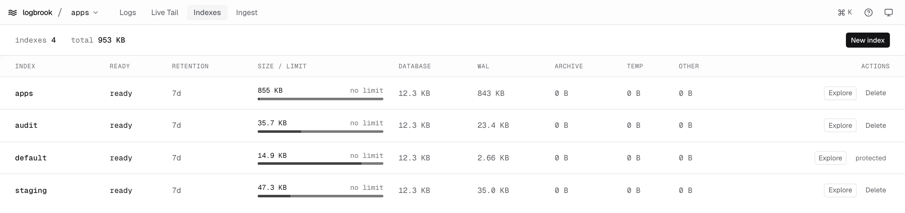
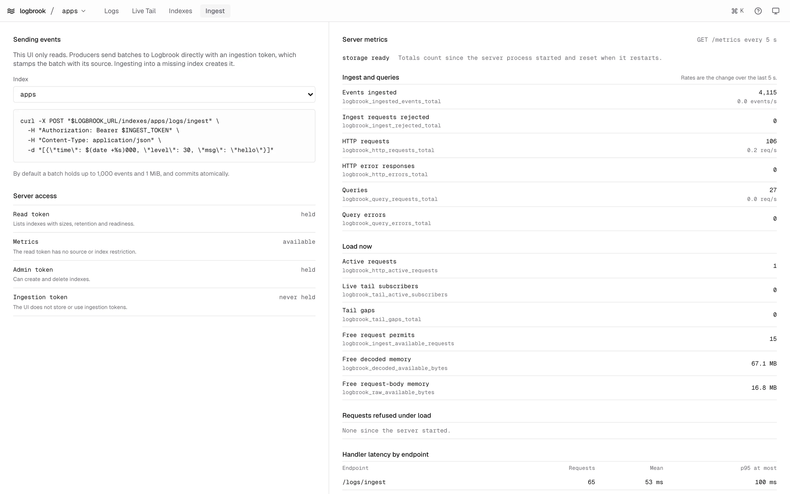

## Indexes

The **Indexes** view lists every index the read token can see, with a summary of how many there are and their total size.

Each row shows the index name, whether it is ready, its retention, its size against its size target (or "no limit"), and the size of the database, WAL, archive, temporary and other files. **Explore** opens the index in Logs. The size figures are the ones the server reports; see [Indexes and retention](/configure/indexes-and-retention/) for what the target means.

<Aside type="note" title="Names only for scoped read tokens">
Logbrook returns only index names to a read token restricted to particular sources. In that case the table has no sizes, retention or readiness, and the UI says so. Configure an unrestricted read token or an admin token for the UI to show them.
</Aside>

### Create and delete indexes

Management needs the UI to have an **admin token** (`LOGBROOK_ADMIN_TOKEN`). Without one the view is read-only, the buttons are hidden and a note says that creating and deleting needs an admin token.

- **New index** asks for a name of 1 to 63 lowercase letters, digits, hyphens or underscores, starting with a letter or digit. It creates an empty index with the server's default retention and size limit, which you set in the server configuration. If Logbrook is at its index limit (four by default, counting `default`), the dialog says so.
- **Delete** asks you to type the index name to confirm. The `default` index is marked protected and can't be deleted. An index declared in the server configuration can't be deleted either: remove it from the configuration and restart the server first.

Anyone who can reach the UI can do both once an admin token is configured. Creating and deleting also goes through a same-origin check: requests from other sites are refused with `403`. That protects against cross-site requests; it does not authenticate people, which is what the reverse proxy is for.

## Ingest and metrics

The **Ingest** view has three parts.

- **Sending events** shows an example `curl` for the index you pick. The UI only reads: your producers send batches straight to Logbrook with an ingestion token. See [Send logs over HTTP](/send-logs/http/).
- **Server access** shows what the UI's tokens allow: whether the read token lists indexes with details or names only, whether metrics are available, and whether an admin token is held. It never holds an ingestion token.
- **Server metrics** shows counters and gauges from the server's Prometheus `/metrics` endpoint, scraped every 5 seconds: events ingested, requests, queries and errors, active requests, live tail subscribers and gaps, free request and memory permits, refused requests and handler latency. Rates appear from the second scrape. Counters count since the server process started.

Metrics need a read token with no source or index restriction. With a restricted token Logbrook answers `403`, the view says so, and the UI stops polling. If a scrape fails after earlier successes, the view marks its figures as out of date. See [Monitoring](/operate/monitoring/) to scrape the same endpoint with Prometheus.
