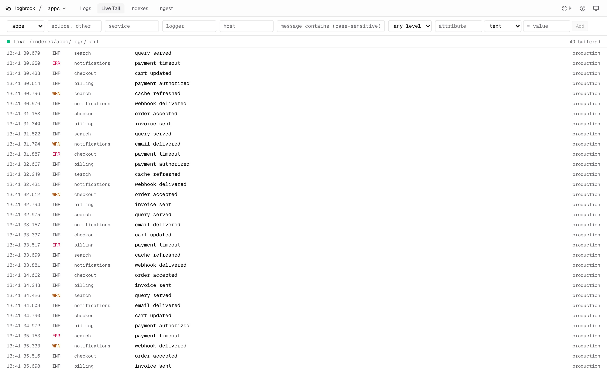

The **Live Tail** view follows an index as events are ingested. It uses the server's [live tail](/query/live-tail/) stream through the UI's proxy, so it shares that endpoint's behaviour and limits.

## Start a tail

Open **Live Tail**, or press `t` from Logs. The tail connects to the current index and shows only events ingested from that moment on; it doesn't replay history. For earlier events use [Logs](/web-ui/explore-logs/).

The status line shows the connection state next to the stream path, and how many events are buffered:

| Status | Meaning |
| --- | --- |
| Connecting | The first connection is being made. |
| Live | The stream is open. |
| Reconnecting | The stream dropped or was refused, and a retry is scheduled or running. |
| Paused while the tab was hidden | The UI closed the stream because the tab was in the background. It reopens when you return. |
| Stopped | The tail ended and won't retry by itself. A notice explains why. |

Times in the tail are shown in UTC.

## Filter the stream

The filter bar takes an index, a comma-separated list of sources, service, logger, host, a message substring (case-sensitive), a minimum level (trace and above through fatal) and attribute conditions. These are the filters the server's tail endpoint accepts. Changing a filter starts a new tail.

Pressing `t` to switch between Logs and Live Tail keeps the index and the filters you have set.

## Read without the list moving

The list follows new events at the bottom. Scroll up and the view freezes, so rows stay put while you read; a button shows how many new events have arrived. Click it, or scroll back to the bottom, to follow the stream again. The UI keeps the newest 10,000 events in memory and says how many older ones it dropped.

## Reconnects and resuming

When the connection drops, the UI reconnects by itself and asks Logbrook to resume after the last event it saw, so a short outage doesn't lose events that Logbrook still retains.

- The delay starts at one second, doubles on each failed attempt up to 30 seconds, and has a little random jitter.
- A `429` (too many live tails) or a server error is retried. If the server sends `Retry-After`, the UI waits at least that long, up to two minutes. The notice shows a countdown and a **Retry now** button.
- A `401` or `403` is not retried. `401` means Logbrook rejected the server's token; `403` means the read token's scope doesn't cover this index or these sources. Pick another index, drop the source filter, or ask the operator for a broader read token.
- Other client errors, such as invalid filters or an unknown index, stop the tail with the server's message.

### Gaps

If the server ends the stream with a `gap` (the resume point has expired under retention, or an event was too large), the tail stops with "Some events were missed". The notice links to **Search this window**, which opens Logs on the time window the tail may have skipped, and offers **Restart from now**.

### Hidden tabs

A tab that has been hidden for 60 seconds closes its tail to free a server slot, and the status shows it as paused. It resumes from the last event when you come back. The server limits concurrent tail subscribers (eight by default) and shares that limit between everyone using the UI. See [Limits and errors](/operate/limits-and-errors/).

<Aside type="note" title="Behind a reverse proxy">
The tail is a long-lived server-sent events stream at `/api/lb/indexes/<index>/logs/tail`. A proxy that buffers responses delays or breaks it. See [Put the UI behind a reverse proxy](/web-ui/reverse-proxy/).
</Aside>
