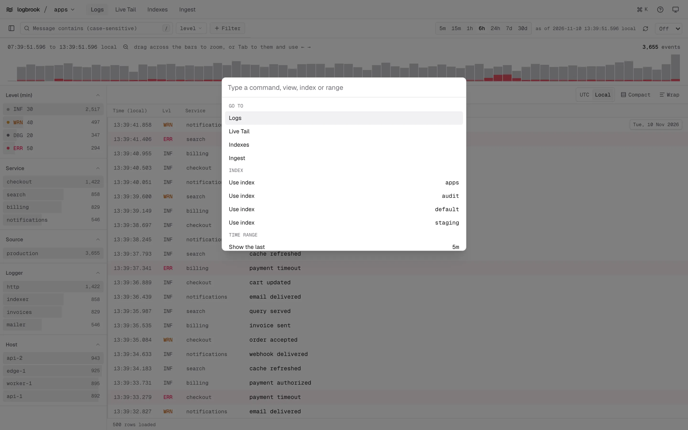
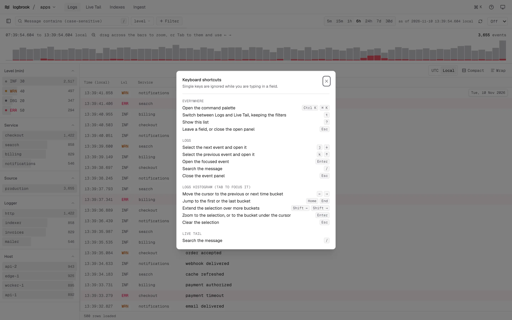

## Command palette

Press `Ctrl K` or `⌘ K`, or click the button at the right of the top bar. Type to filter, and press `Enter` to run a command:

- **Go to** Logs, Live Tail, Indexes or Ingest.
- **Use index** one of the listed indexes.
- **Show the last** `5m` to `30d`, which opens Logs on that range.
- **Theme**: follow the system, light or dark.
- **Keyboard shortcuts**, which opens the list below.

## Shortcuts

Press `?`, or use the help button in the top bar, to see this list in the UI. Single keys are ignored while you type in a field or have a dialog open. `Ctrl K` works while typing too.

| Where | Keys | Action |
| --- | --- | --- |
| Everywhere | `Ctrl K`, `⌘ K` | Open the command palette |
| Everywhere | `t` | Switch between Logs and Live Tail, keeping the filters |
| Everywhere | `?` | Show the shortcut list |
| Everywhere | `Esc` | Leave a field, or close the open panel |
| Logs | `j`, `↓` | Select the next event and open it |
| Logs | `k`, `↑` | Select the previous event and open it |
| Logs | `Enter` | Open the focused event |
| Logs | `/` | Search the message |
| Logs | `Esc` | Close the event panel |
| Logs histogram (`Tab` to focus it) | `←`, `→` | Move the cursor to the previous or next time bucket |
| Logs histogram | `Home`, `End` | Jump to the first or the last bucket |
| Logs histogram | `Shift ←`, `Shift →` | Extend the selection over more buckets |
| Logs histogram | `Enter` | Zoom to the selection, or to the bucket under the cursor |
| Logs histogram | `Esc` | Clear the selection |
| Live Tail | `/` | Search the message |

